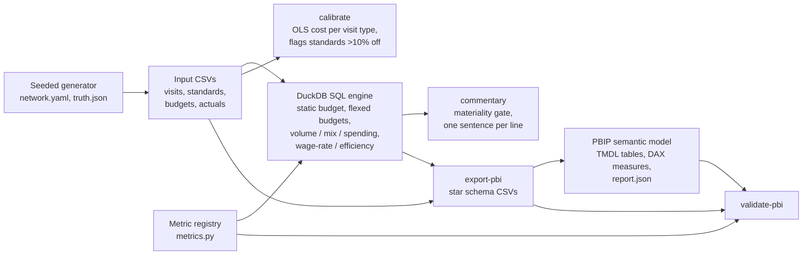

# flexbudget

[](https://github.com/SlateGitOrg/flexbudget/actions/workflows/ci.yml)


flexbudget splits the budget variance of an 18-clinic outpatient network into volume, mix, spending, wage-rate and efficiency parts that add up to the cent, so a clinic that saw 25% more patients is not reported as wasteful. A DuckDB SQL engine is the tested reference; a Power BI project (PBIP: TMDL semantic model plus report definition) reads the exported star schema, and `validate-pbi` checks that project against the CSVs and the engine's metric registry. All data is synthetic and generated from a seed.

## The problem

An outpatient network of 18 primary-care and urgent-care clinics reviews a static budget-versus-actual report every month. A clinic that saw 25% more patients appears to overspend on staff and supplies its patients caused, a clinic with falling volume looks thrifty, and a supply standard set too low in the budget makes every urgent-care clinic look wasteful. Clinic managers stop trusting the report, and the CFO cannot separate volume from efficiency.

The fix is a flexible budget: restate the budget at the volume and case mix the clinic actually had, then compare. What is left is spending, and for clinical labour that splits again into the wage rate paid and the hours used. Because the budget's own standards can be wrong, `calibrate` re-estimates cost per visit from the prior year and reports a bad standard as a budget problem.

## How it works



Per clinic, month and cost line the engine computes:

| Quantity | Definition |
| --- | --- |
| Static budget | budgeted visits by type x standard cost, plus fixed budgets |
| Flexed budget | actual total visits x budgeted mix x standard cost |
| Flexed budget at actual mix | actual visits by type x standard cost |
| Volume variance | flexed - static |
| Mix variance | flexed at actual mix - flexed |
| Spending variance | actual - flexed at actual mix |
| Wage-rate variance | actual hours x (actual rate - standard rate) |
| Efficiency variance | standard rate x (actual hours - standard hours for actual visits) |

Volume + mix + spending = actual - static, and wage-rate + efficiency = clinical-labour spending. Sign convention everywhere: positive means unfavourable. Fixed lines (rent, IT, admin staff, utilities) carry spending variance only.

The synthetic network has 18 clinics (4 small urgent-care sites), 24 months from July 2023, 4 visit types, and 7 cost lines. Actual cost lines are the true cost times a uniform draw within +/-2%. Visit types have distinct seasonal profiles. These patterns are injected and recorded in `truth.json`:

- C07: visits +25% from month 13 at the budgeted mix, costs exactly at standard.
- C12: supplies cost 18% above standard from month 15, volume equal to budget.
- C03: the urgent share of visits climbs from its budgeted level (about 20%) to double that by month 24.
- C15: wage rate +12% (agency nurses) in months 16 to 18, hours at standard.
- C09: closed in month 20 (no visits, fixed costs only).
- The budget's urgent-visit supply standard is 20% below the true cost.

## Quick start

```bash
python -m venv .venv && . .venv/bin/activate
pip install -e ".[dev]"

flexbudget generate --seed 7 --out data/
flexbudget variance --month 2025-03 --clinics C01,C02,C03,C07,C12
flexbudget commentary --month 2025-03
flexbudget calibrate
flexbudget export-pbi --out powerbi/data/
flexbudget validate-pbi
```

`data/` and `powerbi/data/` are committed, so every command also works without running `generate` first. To open the report, set the `DataFolder` parameter in Power BI Desktop to the absolute path of `powerbi/data` and open `powerbi/FlexBudget.pbip`.

## Example output

One month for five clinics (`flexbudget variance --month 2025-03 --clinics C01,C02,C03,C07,C12`):

```text
2025-03  (USD, positive = unfavourable)
clinic static_budget flexed_budget actual_cost volume_variance mix_variance spending_variance total_variance
   C01       170,294       171,041     173,786             747        2,590               154          3,492
   C02        74,808        73,844      77,036            -963        1,373             1,818          2,228
   C03       221,803       222,371     238,525             568        9,943             6,212         16,723
   C07       194,716       228,471     228,037          33,754          -16              -417         33,321
   C12       225,557       225,557     229,273               0            0             3,716          3,716
```

C07 shows a large volume variance and nothing else. C02 is an urgent-care site: most of its spending variance is the understated urgent supply standard. C12 is pure spending. C03's mix variance is the urgent-share shift, and its spending variance also includes the understated urgent supply standard.

Commentary for the month (`flexbudget commentary --month 2025-03`). The share is the dominant component's portion of the gross movement (the sum of the absolute components), so it stays between 0% and 100% even when components offset:

```text
C07 clinical labour, 2025-03: $17,889 unfavourable (20.0% of flexed budget), mainly volume (100% of the gross variance).
C03 medical supplies, 2025-03: $11,756 unfavourable (30.7% of flexed budget), mainly spending (55% of the gross variance).
C07 lab send-outs, 2025-03: $8,079 unfavourable (20.0% of flexed budget), mainly volume (100% of the gross variance).
C07 medical supplies, 2025-03: $7,769 unfavourable (20.0% of flexed budget), mainly volume (100% of the gross variance).
C12 medical supplies, 2025-03: $6,638 unfavourable (18.0% of flexed budget), mainly spending (100% of the gross variance).
```

Standards against the estimate from the first year (`flexbudget calibrate`):

```text
            line visit_type standard estimate std_error    gap         flag
 clinical_labour preventive    24.20    24.04      0.19  +0.7%             
 clinical_labour       sick    22.44    21.62      0.24  +3.8%             
 clinical_labour     urgent    33.00    31.97      0.84  +3.2%             
 clinical_labour  procedure    51.74    51.58      0.59  +0.3%             
medical_supplies preventive     6.00     5.93      0.09  +1.1%             
medical_supplies       sick     9.18     9.00      0.11  +2.0%             
medical_supplies     urgent    20.80    25.94      0.38 -19.8% STANDARD OFF
medical_supplies  procedure    37.24    37.69      0.26  -1.2%             
    lab_sendouts preventive    12.36    12.07      0.08  +2.4%             
    lab_sendouts       sick     9.70    10.12      0.10  -4.1%             
    lab_sendouts     urgent    14.00    14.31      0.36  -2.1%             
    lab_sendouts  procedure    20.40    20.79      0.25  -1.9%
```

Power BI project check (`flexbudget validate-pbi`):

```text
validate-pbi: PASS: 9 tables, 50 columns, 14 measures, 15 relationships, 3 pages, 17 visuals, 39 field bindings
```

## Design decisions

**Round budgets to cents first, then take differences.** Static, flexed and flexed-at-actual-mix budgets are each rounded to cents, and volume, mix and spending are differences of those rounded numbers, so the three parts telescope to actual - static with no residual bucket. The wage-rate variance is computed from its formula; the efficiency variance is the labour spending variance minus it, which differs from the standard-rate formula by at most a cent.

**Materiality compares total variance with the flexed budget.** A clinic-line is flagged when |actual - static| is at least $5,000 and at least 10% of its flexed budget, so a busy clinic whose costs sit exactly on standard (C07) is still reported, with the sentence saying the cause is volume. A closed clinic has a flexed budget of zero, so only the dollar test applies to it and its Variance Pct is null rather than infinite. The cost is that a clinic with a real problem under $5,000 is never mentioned.

**DAX computes from the base facts; FactVariance is only an audit table.** Measures such as Flexed Budget iterate the Standards table against FactBudget and FactVisits rather than summing the engine output, so the model is an independent implementation of the same logic that `validate-pbi` can compare by name. The trade-off is that the DAX cannot run in CI: only names, references, columns and types are checked statically, and the DAX is unrounded where the engine rounds each row to cents.

**Calibration is plain OLS with clinic intercepts on the first 12 months.** Cost per clinic-month is regressed on visits by type, one regression per variable line, and the slopes are the estimated cost per visit type. This keeps the estimate independent of the standards being tested. Intercepts absorb clinic size but throw away between-clinic information, so precision comes from within-clinic variation: the generator gives each visit type its own seasonal profile and a monthly mix surprise. Standard errors are printed; the recovery test allows 5% error.

**Fixed budgets and visit budgets share one FactBudget table.** Visit rows have a blank CostLine and fixed-budget rows have a blank VisitType, which keeps the nine-table star schema. Measures that need visits across all lines therefore remove the CostLine filter explicitly.

**The mix surprise reshuffles types without moving total volume.** Per-type noise in the generator is applied to the shares, not to the counts, so a clinic's volume variance comes only from the clinic-month surprise. Larger type noise makes calibration sharper and also produces genuine mix variances in ordinary months, which the commentary flags (see the limits below).

**Limits of the synthetic checks.** The acceptance claims are verified for the committed seed (7) and the month named in them, not for every seed or month:

- Commentary: for 2025-03 with seed 7 the flagged set is exactly C07 (three lines), C12 supplies and C03 supplies. Over all 24 months with seed 7 the gate flags 97 clinic-line-months, 38 of which are not injected effects (almost all supplies mix, caused by the 20% per-type share noise). Over seeds 1 to 30, the 2025-03 flagged set contains the injected lines and no other clinic in 18 of 30 seeds.
- Calibration: with seed 7 every cost per visit is recovered within 4.0%. Over seeds 1 to 30 the worst error per seed has median 3.1% and range 1.5% to 7.1%, and is under 5% in 24 of 30 seeds. The understated urgent supply standard is the only standard flagged in all 30 seeds. Precision is limited by 18 clinics x 12 months of data with +/-2% cost noise, not by the method.

## Testing

```bash
pytest -q
ruff check . && ruff format --check .
```

The suite runs offline and checks behaviour against hand-computed fixtures and the injected patterns: the decomposition identity for every clinic-line-month, the wage/efficiency split, each injected effect recovered from the engine output, calibration recovery within 5% with only the urgent supply standard flagged, the commentary gate, the CSV round trip of FactVariance, and `validate-pbi` on the shipped project plus broken copies (a measure on a missing column, a measure missing from the registry, a CSV header or type mismatch, a visual bound to a missing field).

## Project layout

```text
src/flexbudget/
  network.yaml       scenario: true costs, standards, clinics, injections
  generate.py        seeded generator and truth.json
  inputs.py          input loading and checks
  sql/               DuckDB scripts: unit costs, visit grid, budgets, variance
  engine.py          runs the SQL, rolls results up
  metrics.py         metric registry shared by engine and model
  calibrate.py       OLS cost per visit type
  commentary.py      materiality gate and sentences
  starschema.py      table and column definitions of the star schema
  export.py          writes the star-schema CSVs
  tmdl.py, pbip.py   TMDL parser and validate-pbi checks
  cli.py             typer commands
data/                generated inputs (seed 7)
powerbi/
  FlexBudget.pbip
  FlexBudget.SemanticModel/   definition.pbism, model, expressions, relationships, tables
  FlexBudget.Report/          definition.pbir, report.json (3 pages)
  data/                       star-schema CSVs
tests/
```

## License

MIT. See `LICENSE`.
